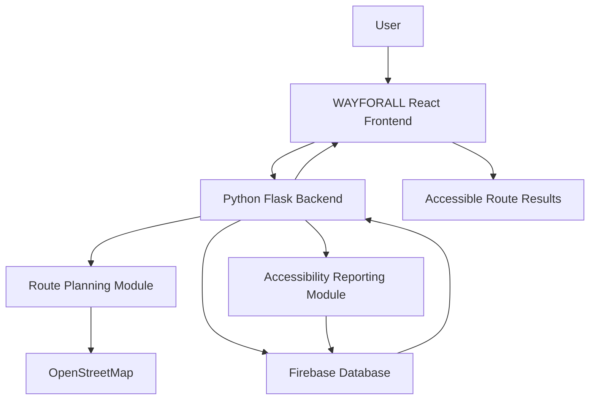

# WAYFORALL – Technical Design Document

## 1. Project Overview
WAYFORALL is an accessible navigation platform designed to help wheelchair users find suitable pedestrian routes.

## 2. System Architecture

The system consists of the following components:

- Frontend: React
- Backend: Python Flask
- Database: Firebase
- Mapping: OpenStreetMap
- Route Calculation: Graph Algorithms

## 3. Main Modules

1. User Registration and Profile Management
2. Accessibility Preferences
3. Accessible Route Finder
4. Barrier Reporting
5. Accessibility Information Dashboard

## 4. System Workflow

1. User opens the application.
2. User enters the destination.
3. User selects accessibility preferences.
4. The system evaluates available route information.
5. The application suggests a suitable accessible route.

## 5. Expected Outcome

The platform aims to improve independent mobility by helping users identify accessible pathways and avoid reported physical barriers.

## 6. Future Enhancements

- AI-based barrier detection.
- Regional language voice navigation.
- Real-time accessibility updates.
- Integration with public transport information.

## System Architecture Diagram

The following diagram illustrates the proposed architecture of WAYFORALL.

